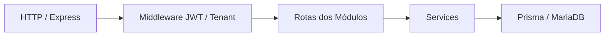

<div align="center">
  
</div>

<div align="center">

# S A A S　//　P R O T E Ç Ã O　V E I C U L A R

### `NODE.JS • TYPESCRIPT • MULTI-TENANT • SECURITY`

**Backend modular para associações de proteção veicular, com autenticação, isolamento por tenant e API REST.**


`FATEC` · `ADS` · `BACKEND / LAB`

[Visão geral](#visao-geral) · [Módulos](#modulos) · [Arquitetura](#arquitetura) · [Execução](#execucao)

</div>

---

<a id="visao-geral"></a>

## `PROJECT // VISÃO GERAL`

Backend modular para associações de proteção veicular, com autenticação, isolamento por tenant e API REST.

## `SYSTEM // STATUS`

| Componente | Situação no repositório |
| :--- | :---: |
| Autenticação e refresh tokens; middleware JWT | `● DOCUMENTADO` |
| Módulos de usuários, tenants, veículos e uploads | `● DOCUMENTADO` |
| Módulos de vistoria, contratos e pagamentos presentes no código | `● DOCUMENTADO` |
| Validação e segurança com RBAC, Zod e rate limiting | `● DOCUMENTADO` |
| Migrações Prisma versionadas em `prisma/migrations/` | `● DOCUMENTADO` |

<a id="modulos"></a>

## `CORE // CONTEÚDO`

- Autenticação e refresh tokens; middleware JWT
- Módulos de usuários, tenants, veículos e uploads
- Módulos de vistoria, contratos e pagamentos presentes no código
- Validação e segurança com RBAC, Zod e rate limiting
- Migrações Prisma versionadas em `prisma/migrations/`

<a id="arquitetura"></a>

## `ARCHITECTURE // FLUXO CONCEITUAL`



<a id="execucao"></a>

## `BOOT SEQUENCE // EXECUÇÃO LOCAL`

```bash
git clone https://github.com/gilbertocorrea-cmd/Saas-Protecao-Veicular.git
cd Saas-Protecao-Veicular
```

Após clonar, instale dependências com `npm install`. Configure as variáveis de ambiente necessárias antes de iniciar. O README original documenta `npx prisma migrate dev` e `npm run dev`. Confira também [`ARCHITECTURE.md`](ARCHITECTURE.md) para arquitetura e regras.

A existência de módulos no código não significa que todos os fluxos estejam finalizados: a situação de cada módulo segue descrita no documento técnico original.

---

## `DOCUMENTATION // DETALHES ORIGINAIS`


Backend de um sistema SaaS White Label para gestão de associações de proteção veicular.

Projeto desenvolvido com foco em:

- Multi-Tenant
- Segurança
- Escalabilidade
- Arquitetura Modular
- Boas práticas de desenvolvimento

---

# 📌 Sobre o Projeto

O objetivo do sistema é permitir que múltiplas associações de proteção veicular utilizem a mesma aplicação com isolamento completo de dados entre clientes (tenants).

A arquitetura foi construída para suportar crescimento gradual, adicionando módulos conforme a evolução do negócio.

---

# 🛠️ Stack Tecnológica

## Backend

- Node.js
- TypeScript
- Express.js

## Banco de Dados

- MariaDB
- Prisma ORM

## Segurança

- JWT RS256
- Refresh Token Rotation
- Bcrypt
- RBAC
- Rate Limiting
- Validação com Zod

## Infraestrutura

- Multi-Tenant
- AsyncLocalStorage
- Prisma Middleware

---

# 🏗️ Arquitetura

O projeto segue arquitetura modular:

```text
src/
├── modules/
├── middleware/
├── services/
├── config/
├── shared/
└── prisma/
```

Cada módulo possui sua própria separação de responsabilidades:

```text
module/
├── controller
├── service
├── routes
├── schemas
```

---

# 🔐 Segurança Implementada

### Autenticação

- JWT RS256
- Access Token
- Refresh Token
- Rotação de Tokens
- Logout Seguro

### Senhas

- Hash com Bcrypt
- Nunca armazenadas em texto puro

### Validação

- Zod
- Sanitização de entrada
- Tratamento centralizado de erros

### Proteções

- Rate Limit
- Controle de acesso por perfil
- Isolamento por tenant

---

# 🏢 Multi-Tenant

Implementado utilizando:

- tenantId em entidades
- AsyncLocalStorage
- Middleware de contexto
- Prisma Middleware

Benefícios:

- Isolamento automático
- Segurança entre clientes
- Escalabilidade

Nenhuma consulta depende do desenvolvedor lembrar de aplicar filtros manualmente.

---

# 🔑 RBAC (Role Based Access Control)

Perfis disponíveis:

```text
ADMIN_MASTER
GESTOR
FUNCIONARIO
CLIENTE
```

Regras:

- ADMIN_MASTER gerencia o SaaS
- GESTOR gerencia sua associação
- FUNCIONARIO possui permissões operacionais
- CLIENTE possui acesso restrito

---

# 📋 Módulos Implementados

## ✅ Auth

- Login
- JWT
- Refresh Token
- Rotação de Tokens
- Controle de Sessão

## ✅ User

- CRUD
- Controle de Status
- RBAC
- Token Version

## ✅ Tenant

- Cadastro
- Controle de Tenant
- Suspensão
- Reativação

## ✅ Vehicle

- CRUD
- Estrutura FIPE
- Base para vistoria

## ✅ Upload

- Upload de arquivos
- Organização por tenant

---

# 🚧 Em Desenvolvimento

## Inspection

- Vistorias
- Upload de imagens
- Fluxo operacional

## Contract

- Contratos
- PDF
- Assinaturas

## Payment

- PIX
- Webhooks
- Integração financeira

---

# 📅 Planejado

## Claim

- Gestão de Sinistros

## AI

- Análise Antifraude
- Score de Risco

## Notification

- Email
- WhatsApp
- Alertas

## Dashboard

- Indicadores
- Relatórios
- KPIs

---

# 📊 Status Atual

| Módulo | Status |
|---------|---------|
| Auth | ✅ |
| Multi-Tenant | ✅ |
| RBAC | ✅ |
| User | ✅ |
| Tenant | ✅ |
| Vehicle | ✅ |
| Upload | ✅ |
| Inspection | 🚧 |
| Contract | 🚧 |
| Payment | 🚧 |
| Claim | ❌ |
| AI | ❌ |
| Dashboard | ❌ |

---

# 📚 Aprendizados Aplicados

Este projeto utiliza conceitos de:

- Arquitetura em Camadas
- Clean Code
- SOLID
- REST API
- Multi-Tenancy
- JWT
- Refresh Token Rotation
- RBAC
- Prisma ORM
- MariaDB
- TypeScript
- Express.js

---

# ⚙️ Instalação

## Clonar

```bash
git clone https://github.com/gilbertocorrea-cmd/Saas-Protecao-Veicular.git
```

## Instalar dependências

```bash
npm install
```

## Executar migrations

```bash
npx prisma migrate dev
```

## Iniciar servidor

```bash
npm run dev
```

---

# 👨‍💻 Autor

**Gilberto Corrêa Filho**

- ADS — FATEC Arthur de Azevedo
- Backend Developer
- Node.js
- TypeScript
- Segurança da Informação
- Linux

GitHub:

https://github.com/gilbertocorrea-cmd

---

<div align="center">

## `SAAS PROTECAO VEICULAR // BUILD • LEARN • EVOLVE`

**Gilberto Corrêa** · ADS — FATEC

[GitHub](https://github.com/gilbertocorrea-cmd)

</div>
